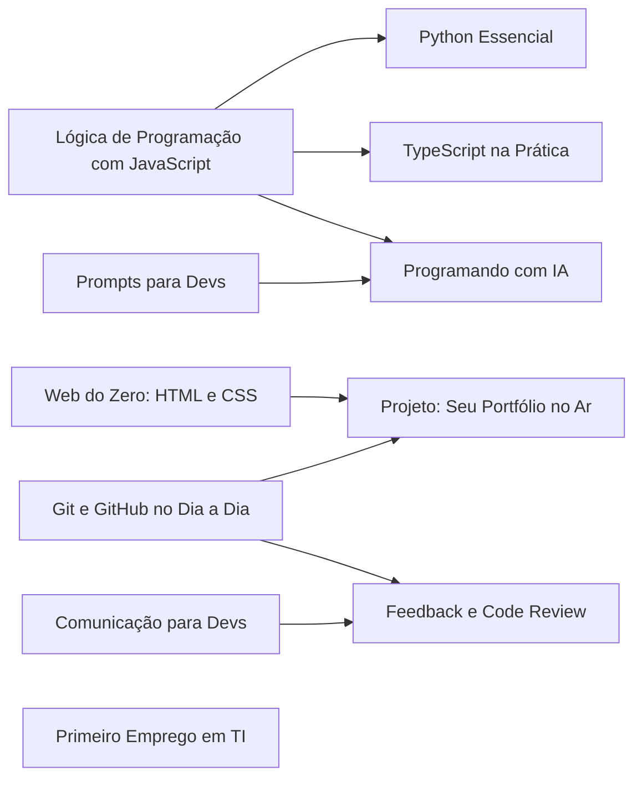

# 20 — Launch curriculum

The courses Codify launches with: who they are for, how a lesson is built,
which course owns which concept, and the syllabus of every course. The
content itself lives in [`content/courses/`](../content/courses) and is
loaded with `tools/content` (see [Authoring format](#7-authoring-format-and-loading)).

Source language is **pt-BR**; every course ships with a full **en-US**
translation.

## 1. Who we teach

From [00-vision.md](./00-vision.md): the career-changer (adult, little or no
programming, easily discouraged), the junior or student (building depth and
tooling fluency) and the working developer (targeted upskilling). The four
onboarding goals map to the four categories:

| Onboarding goal | Category (slug)                                              | Starts with                             |
| --------------- | ------------------------------------------------------------ | --------------------------------------- |
| `career`        | Programação / Programming (`programming`)                    | Lógica de Programação com JavaScript    |
| `newTech`       | Programação / Programming (`programming`)                    | Python Essencial, TypeScript na Prática |
| `ai`            | IA para Devs / AI for Developers (`ai`)                      | Prompts para Devs                       |
| `softSkills`    | Carreira / Career (`career`) and Soft Skills (`soft-skills`) | Comunicação para Devs                   |

Category names carry the words the "Recommended next" ranking looks for
(`program`, `ia`/`ai`, `carreira`/`career`, `soft`).

## 2. Lesson design rules

1. **One idea per lesson, five to eight minutes.** A reading is 200–350
   words in the source language. If it needs more, it is two lessons.
2. **Teach, then practise at once.** No more than two readings in a row; a
   module never ends on a reading.
3. **Module shape.** Four to six lessons. The last lesson is practice that
   combines the module's ideas: a challenge (exercise, scenario or AI
   prompt) or a quiz that mixes everything the module taught.
4. **Lesson types** (what each is for):
   - `READING` — explains one idea with one worked example. Uses headings,
     short paragraphs, code blocks, at most two callouts. No graded
     questions inside.
   - `QUIZ` — three to five questions on the readings just before it. Every
     question has an explanation that teaches, including why the wrong
     options are wrong. Kinds: single, multiple, match, order. Quiz lessons
     feed spaced-repetition reviews, so questions must stand on their own
     (no "as seen above").
   - `EXERCISE` — one function to write (JavaScript, TypeScript, Python) or
     one small page to build (web). The lesson body states the task, the
     rules and one example. Two to three visible tests, two to four hidden
     tests for edge cases named in the task. Starter code compiles and
     fails; the reference solution passes every test.
   - `AI_PROMPT` — the learner writes text (a prompt, a message, a review)
     that a rubric grades. Rubrics mix cheap deterministic checks (length,
     required elements) with judged criteria. The task states what a good
     answer contains; the rubric never checks for something the task did
     not ask for.
   - `SCENARIO` — a branching conversation, at least two decisions deep,
     with three or more endings. Each wrong path shows a realistic
     consequence, never a lecture.
   - `CAPSTONE` — a project submission (repository link and write-up)
     graded by a rubric.
5. **Rewards** stay at the per-type defaults ([07-gamification.md](./07-gamification.md) §2);
   authors do not tune XP or coins per lesson.
6. **Free preview.** Module 1 of every course is free. The capstone course
   has one free lesson (the brief).
7. **Voice.** Second person, warm and direct, no jargon before it is
   defined. Examples come from everyday Brazilian life in pt-BR (PIX, a
   market stall, a football table) and are localised, not literally
   translated, in en-US. Identifiers in code are in the lesson's language
   for beginners' courses (`calcularFrete` / `calculateShipping`) so the
   two locales are separate exercises with the same tests.
8. **No vendor tutorials.** AI lessons teach habits that work with any
   assistant; no product names, no screenshots of a specific tool. Git
   lessons use plain `git` commands and name GitHub only for pull requests
   and Pages.
9. **No advice we are not qualified to give.** Career lessons explain how
   hiring usually works and what to ask; they do not give legal, tax or
   financial advice (contract types are described, not recommended).
10. **Accessibility.** Every image has alt text; code is never shown only
    as an image; colour is never the only signal in an example.

## 3. Catalog and order

Eleven courses and 214 lessons in four categories. Arrows are prerequisites: a course
assumes what its prerequisite owns (§4) and does not re-teach it.

| Id  | Slug                    | pt-BR title                          | en-US title                       | Category             | Level | Lessons |
| --- | ----------------------- | ------------------------------------ | --------------------------------- | -------------------- | ----- | ------- |
| P1  | `logica-javascript`     | Lógica de Programação com JavaScript | Programming Logic with JavaScript | programming          | 1     | 26      |
| P2  | `web-html-css`          | Web do Zero: HTML e CSS              | Web from Scratch: HTML and CSS    | programming          | 1     | 26      |
| P3  | `python-essencial`      | Python Essencial                     | Python Essentials                 | programming          | 2     | 25      |
| P4  | `typescript-pratica`    | TypeScript na Prática                | TypeScript in Practice            | programming          | 3     | 19      |
| A1  | `prompts-para-devs`     | Prompts para Devs                    | Prompting for Developers          | ai                   | 1     | 18      |
| A2  | `programando-com-ia`    | Programando com IA                   | Coding with AI                    | ai                   | 2     | 18      |
| K1  | `git-github`            | Git e GitHub no Dia a Dia            | Git and GitHub Day to Day         | career               | 1     | 19      |
| K2  | `primeiro-emprego-ti`   | Primeiro Emprego em TI               | Your First Tech Job               | career               | 1     | 18      |
| S1  | `comunicacao-para-devs` | Comunicação para Devs                | Communication for Developers      | soft-skills          | 1     | 19      |
| S2  | `feedback-code-review`  | Feedback e Code Review               | Feedback and Code Review          | soft-skills          | 2     | 18      |
| X1  | `projeto-portfolio`     | Projeto: Seu Portfólio no Ar         | Project: Ship Your Portfolio      | programming + career | 2     | 8       |

X1 is the capstone course (`isCapstone`).

## 4. Concept ownership

Each concept is **taught** in one course only. Other courses may use it and
link back, but never explain it again. An author who needs a concept owned
elsewhere writes one sentence and names the owning course.

| Concept                                                                                                                                     | Owner |
| ------------------------------------------------------------------------------------------------------------------------------------------- | ----- |
| What a program is; values and types; variables; operators                                                                                   | P1    |
| Conditionals; loops; functions, parameters, return, scope                                                                                   | P1    |
| Arrays and objects as ideas (lists of things, things with properties)                                                                       | P1    |
| Reading an error message; a debugging routine                                                                                               | P1    |
| How the web works (browser, server, HTML/CSS/JS roles)                                                                                      | P2    |
| HTML elements, semantics, links, images, lists, tables, forms                                                                               | P2    |
| CSS selectors, the box model, flexbox, responsive basics                                                                                    | P2    |
| Web accessibility basics (alt text, labels, heading order, contrast)                                                                        | P2    |
| Python syntax and idioms: indentation, f-strings, slicing, dicts, sets, comprehensions, keyword arguments, exceptions, the standard library | P3    |
| Static types: annotations, inference, interfaces, unions, narrowing, generics, utility types                                                | P4    |
| What a language model is; context; hallucination; non-determinism                                                                           | A1    |
| The parts of a good prompt; examples and output formats; iteration                                                                          | A1    |
| Privacy, secrets and licences when using AI                                                                                                 | A1    |
| The AI coding workflow (plan, small steps, review, test)                                                                                    | A2    |
| Failure modes of AI-written code and how to catch them                                                                                      | A2    |
| Tests as a safety net; writing tests first                                                                                                  | A2    |
| Version control ideas; commit, branch, merge, conflict; remotes                                                                             | K1    |
| The mechanics of a pull request; commit messages; undoing mistakes                                                                          | K1    |
| Tech roles; portfolio; CV; profiles; interviews; offers; first 90 days                                                                      | K2    |
| Clear writing; asking for help; status updates; non-technical audiences                                                                     | S1    |
| Saying no; scope; estimates; meetings; remote and async work                                                                                | S1    |
| Giving and receiving feedback (SBI); disagreement                                                                                           | S2    |
| Code review as reviewer and as author; pull-request descriptions                                                                            | S2    |
| Publishing a static site; a project README                                                                                                  | X1    |

Deliberate boundaries between neighbours:

- **P1 vs P3.** P3 assumes P1's ideas. Its first lesson maps them to Python
  syntax in one page; no lesson explains what a variable or a loop is.
- **P1 vs P4.** P4 never re-teaches JavaScript; it adds types to code the
  learner can already write.
- **A1 vs A2.** A1 is about what you write to the assistant. A2 is about
  what you do with what comes back. A2 writes no "how to prompt" lessons.
- **A2 vs testing in general.** A2 owns the idea of tests as a safety net,
  using plain assertions on functions; no test framework is taught at
  launch.
- **K1 vs S2.** K1 covers how a pull request works (branch, push, open,
  merge). S2 covers what people write in it and how they talk about it.
- **K2 vs S1.** K2 covers communication only where it is job-hunting
  (pitch, CV bullets, interview answers). Everyday workplace communication
  is S1.
- **S1 vs S2.** S1 is one-to-many and upward communication (messages,
  updates, clients, scope). S2 is peer feedback on work.
- **P2 vs X1.** X1 teaches no new HTML or CSS; it applies P2 and adds only
  planning, publishing and the README.

## 5. Syllabus

Legend: **R** reading · **Q** quiz · **E** exercise (JS/TS/Python) ·
**W** web exercise · **A** AI prompt · **S** scenario · **C** capstone.
Module 1 of each course is free.

### P1 — Lógica de Programação com JavaScript (26)

For someone who has never programmed. By the end they can read and write
small functions with conditions, loops, arrays and objects, and find their
own bugs.

1. **Primeiros passos** — R O que é programar · R Valores e tipos · Q Qual é
   o tipo? · R Variáveis · E Sua primeira função (`saudacao`)
2. **Decisões** — R Comparações e booleanos · R `if` e `else` · E Maior de
   idade? · Q Lendo condições · E Desafio: frete grátis
3. **Repetição** — R `while` e `for` · E Somar até N · R Arrays · E O maior
   valor · Q Laços e arrays · E Desafio: contar vogais
4. **Funções** — R Parâmetros e retorno · E Média das notas · R Escopo e
   funções que chamam funções · Q O que esta função retorna? · E Desafio:
   senha válida
5. **Dados e depuração** — R Objetos · E Total do carrinho · R Lendo
   mensagens de erro · Q Rotina de depuração · E Desafio final: resumo do
   pedido

### P2 — Web do Zero: HTML e CSS (26)

For a beginner who wants to see something on screen. By the end they can
build and style a small, accessible, responsive page.

1. **Sua primeira página** — R Como a web funciona · R Tags e elementos ·
   W Título e parágrafo · R Links e imagens · W Um link e uma imagem ·
   Q Fundamentos de HTML
2. **Estrutura e semântica** — R Tags semânticas · W Esqueleto de página ·
   R Listas e tabelas · W Lista de compras · Q Qual tag usar?
3. **CSS essencial** — R Seletores e propriedades · W Cores e texto ·
   R O modelo de caixa · W Espaço e bordas · Q Modelo de caixa
4. **Layout** — R Flexbox · W Itens em linha · R Páginas responsivas ·
   W Cartões que se adaptam · Q Layout
5. **Formulários e acessibilidade** — R Formulários · W Formulário de
   contato · R Acessibilidade na prática · Q Acessível ou não? ·
   W Desafio final: cartão de perfil

### P3 — Python Essencial (25)

For someone who finished P1 or already programs in another language. By
the end they write idiomatic Python for everyday data tasks.

1. **Python para quem já programa** — R De JavaScript para Python · E Olá
   com f-strings · R Tipos, conversões e valores "verdadeiros" · Q Tipos em
   Python · E Faixa etária
2. **Coleções** — R Listas e fatiamento · E Top 3 · R Dicionários ·
   E Contar palavras · R Tuplas e conjuntos · Q Qual coleção usar?
3. **Python idiomático** — R `for`, `range`, `enumerate`, `zip` ·
   E Ranking numerado · R Compreensões · E Só os pares ao quadrado ·
   Q Idiomático ou não?
4. **Funções e erros** — R Argumentos padrão e nomeados · E Formatar preço ·
   R Exceções e tracebacks · E Divisão segura · Q Lendo um traceback
5. **Biblioteca padrão** — R Módulos que já vêm prontos · E Estatísticas
   da turma · Q Onde está o que eu preciso? · E Desafio final: relatório
   de vendas

### P4 — TypeScript na Prática (19)

For someone comfortable with JavaScript. By the end they model data with
types and let the compiler catch mistakes.

1. **Por que tipos** — R O erro que o tipo pega · R Anotações e inferência ·
   Q Compila ou não compila? · E Função tipada
2. **Modelando dados** — R Interfaces e tipos · E Tipo `Produto` ·
   R Opcional e somente leitura · Q Qual é o tipo? · E Desafio: carrinho
   tipado
3. **Uniões e refinamento** — R Uniões e tipos literais · E Status do
   pedido · R Refinamento · E Formas e áreas · Q Refinamento
4. **Genéricos e utilitários** — R Genéricos · E `primeiro<T>` · R Tipos
   utilitários · Q `Partial`, `Pick` ou `Record`? · E Desafio final:
   agrupar por chave

### A1 — Prompts para Devs (18)

For anyone who uses an AI assistant for code. By the end they write
prompts that get usable answers and know what not to trust or paste.

1. **Como a IA "pensa"** — R O que é um modelo de linguagem · Q Mitos e
   fatos · R Contexto é tudo · A Conserte um prompt vago
2. **Anatomia de um bom prompt** — R As cinco partes · Q Monte o prompt ·
   A Peça uma função com restrições · R Exemplos e formato de saída ·
   A Peça uma resposta em JSON
3. **Prompts do dia a dia** — R Depurando com IA · A Peça ajuda com um bug ·
   R Testes e documentação · A Peça testes · Q Qual prompt é melhor?
4. **Limites e responsabilidade** — R Alucinações e verificação · R Dados,
   segredos e licenças · S O colega e os dados do cliente · A Desafio
   final: o prompt completo

### A2 — Programando com IA (18)

For someone who can write small functions (P1) and prompt (A1). By the end
they treat AI output as a draft: they review it, test it and decide.

1. **O fluxo de trabalho** — R Planejar, gerar, revisar, testar · Q A ordem
   importa · R Passos pequenos · A Quebre a tarefa
2. **Caça aos erros** — R Como a IA erra em código · E O laço que para cedo
   demais · E A lista vazia · Q A função que não existe · E A validação
   esquecida
3. **Testes como rede de segurança** — R Teste primeiro · E Faça os testes
   passarem · R Revisando testes escritos por IA · Q Este teste prova
   algo? · A Peça os casos de borda
4. **Julgamento** — R Quando não usar IA · S O prazo e o código sem teste ·
   Q Confiar, verificar ou descartar? · A Desafio final: revise o código
   da IA

### K1 — Git e GitHub no Dia a Dia (19)

For anyone about to work on code with other people. By the end they can
follow a normal branch and pull-request flow and get out of common
trouble.

1. **Por que versionar** — R O problema que o Git resolve · R As três
   áreas · Q Seu primeiro commit, passo a passo · Q Comando e efeito
2. **Ramificações** — R Branches · Q Em que branch estou? · R Merge e
   conflitos · Q Resolvendo um conflito, na ordem · S O conflito com a
   colega
3. **Trabalhando em equipe** — R Repositórios remotos · Q `clone`, `pull`
   ou `push`? · R O caminho de um pull request · Q O fluxo, na ordem ·
   R Boas mensagens de commit · A Escreva a mensagem de commit
4. **Quando dá errado** — R Desfazendo com segurança · Q Qual comando
   desfaz o quê? · S A senha que foi para o repositório · Q Revisão final

### K2 — Primeiro Emprego em TI (18)

For someone looking for a first job or internship in tech. By the end they
have a pitch, a stronger CV line, and a plan for interviews and offers.

1. **O mapa da área** — R Quem faz o quê · Q Cargo e atividade · R O que se
   espera de uma pessoa júnior · A Seu pitch em três frases
2. **Vitrine** — R Portfólio: poucos projetos, bem contados · R Currículo
   de uma página · A Reescreva a linha do currículo · R Perfis: LinkedIn e
   GitHub · Q Sua vitrine
3. **Entrevistas** — R Entrevista comportamental e o método STAR · A Sua
   resposta em STAR · R Entrevista técnica: pense em voz alta · S A
   pergunta que você não sabe · Q Entrevistas
4. **Proposta e começo** — R Lendo uma proposta · S Negociando a proposta ·
   R Os primeiros 90 dias · Q Revisão final

### S1 — Comunicação para Devs (19)

For anyone who works on a team. By the end they write messages people can
act on and handle the common hard conversations.

1. **Escrever para ser entendido** — R Comece pela conclusão · A Reescreva a
   mensagem confusa · R Como pedir ajuda · A Peça ajuda do jeito certo ·
   Q Qual mensagem funciona?
2. **Alinhamento** — R Atualizações de status · A Escreva a atualização ·
   R Falando com quem não é técnico · S Explicando o atraso ao cliente ·
   Q Alinhamento
3. **Conversas difíceis** — R Dizer não e negociar escopo · S Só mais uma
   coisinha · R Estimativas e incerteza · S O prazo impossível ·
   Q Conversas difíceis
4. **Reuniões e trabalho remoto** — R Reuniões que valem o tempo ·
   R Assíncrono primeiro · S O mal-entendido no chat · A Desafio final:
   resumo do incidente

### S2 — Feedback e Code Review (18)

For someone who gives or receives reviews (K1 and S1 recommended). By the
end they give feedback people can use and take review without drama.

1. **Feedback que ajuda** — R Situação, comportamento, impacto · Q É
   feedback ou é julgamento? · A Reescreva o feedback duro · S Recebendo
   uma crítica difícil
2. **Revisando o código dos outros** — R O que revisar e o que deixar para
   a máquina · R Comentários que ajudam · A Reescreva o comentário ·
   Q Detalhe ou bloqueio? · S O PR gigante do júnior
3. **Tendo seu código revisado** — R PR pequeno, bem descrito · A Escreva a
   descrição do PR · R Respondendo a críticas · S Quando você acha que o
   revisor errou · Q Autor e revisor
4. **Conflito e crescimento** — R Discordar sem brigar · S Dois seniores,
   duas opiniões · R Pedindo feedback para crescer · Q Revisão final

### X1 — Projeto: Seu Portfólio no Ar (8)

Capstone. For someone who finished P2 and K1. They plan, build, publish
and present a one-page portfolio.

1. **O projeto** — R O desafio e como ele é avaliado (free) · R Planeje
   antes de codar · W Esqueleto do portfólio · W Estilo e responsividade
2. **No ar** — R Publicando com GitHub Pages · R Um README que apresenta o
   projeto · A Escreva seu README · C Entrega do projeto

## 6. Quality gates

A course is published only when all of these hold. The first five are
checked by `tools/content` (`validate`); the last three by an editorial
review.

1. Every lesson document passes `lessonDocSchema`.
2. pt-BR and en-US have the same structure: same lessons, same block
   sequence, same quiz ids, option counts and answer keys, same scenario
   graph, same tests.
3. Every reference solution passes all its tests, and every starter fails
   at least one.
4. Every scenario has an ending reachable from the start, is at least two
   decisions deep on its best path and has three or more endings.
5. Every rubric validates, its weights are sensible, and the pass mark can
   be reached by an answer that does what the task asks.
6. The lesson matches its syllabus line and the rules in §2.
7. No concept is taught outside its owner (§4), and nothing a lesson relies
   on is taught later in the course or in a course that is not a
   prerequisite.
8. A fluent reader of each language finds no errors of fact, language or
   tone.

## 7. Authoring format and loading

One folder per course under `content/courses/<slug>/`: a `course.yml`
(metadata, modules and lesson order) and one YAML file per lesson holding
both languages side by side. Lesson bodies are a small Markdown dialect
compiled to the lesson document; quizzes, exercises, AI prompts and
scenarios are structured YAML. The exact format, the validator and the
loader are documented in [`tools/content/README.md`](../tools/content/README.md).

Loading goes through the API (never straight to the database), so every
server-side check runs: `node tools/content/load.mjs --api <url>`.
It is idempotent: courses are found by slug and lessons by a stable key,
and a second run updates what changed.
