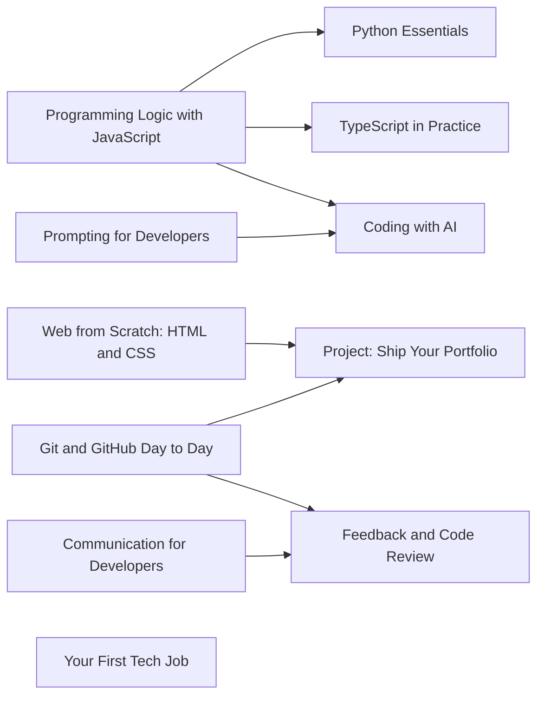

# 20 — Launch curriculum

The courses Codify launches with: who they are for, how a lesson is built,
which course owns which concept, and the syllabus of every course. The
content itself lives in [`content/courses/`](../content/courses) and is
loaded with `tools/content` (see [Authoring format](#7-authoring-format-and-loading)).

Source language is **en-US**; every course ships with a full **pt-BR**
translation. English is first everywhere: course titles, slugs, code
identifiers and the platform's default language.

## 1. Who we teach

From [00-vision.md](./00-vision.md): the career-changer (adult, little or no
programming, easily discouraged), the junior or student (building depth and
tooling fluency) and the working developer (targeted upskilling). The four
onboarding goals map to the four categories:

| Onboarding goal | Category (slug)                                              | Starts with                               |
| --------------- | ------------------------------------------------------------ | ----------------------------------------- |
| `career`        | Programming / Programação (`programming`)                    | Programming Logic with JavaScript         |
| `newTech`       | Programming / Programação (`programming`)                    | Python Essentials, TypeScript in Practice |
| `ai`            | AI for Developers / IA para Devs (`ai`)                      | Prompting for Developers                  |
| `softSkills`    | Career / Carreira (`career`) and Soft Skills (`soft-skills`) | Communication for Developers              |

Category names carry the words the "Recommended next" ranking looks for
(`program`, `ai`/`ia`, `career`/`carreira`, `soft`) in both languages.

## 2. Lesson design rules

1. **One idea per lesson, five to eight minutes.** A reading is 200–350
   words in English. If it needs more, it is two lessons.
2. **Teach, then practise at once.** No more than two readings in a row; a
   module never ends on a reading.
3. **Module shape.** Four to six lessons. The last lesson is practice that
   combines the module's ideas: a challenge (exercise, scenario or AI
   prompt) or a quiz that mixes everything the module taught.
4. **Lesson types** (what each is for):
   - `READING` — explains one idea with one worked example. Uses headings,
     short paragraphs, code blocks, at most two callouts. No graded
     questions inside.
   - `QUIZ` — three to five questions on the readings just before it. Every
     question has an explanation that teaches, including why the wrong
     options are wrong. Kinds: single, multiple, match, order. Quiz lessons
     feed spaced-repetition reviews, so questions must stand on their own
     (no "as seen above").
   - `EXERCISE` — one function to write (JavaScript, TypeScript, Python) or
     one small page to build (web). The lesson body states the task, the
     rules and one example. Two to three visible tests, two to four hidden
     tests for edge cases named in the task. Starter code compiles and
     fails; the reference solution passes every test.
   - `AI_PROMPT` — the learner writes text (a prompt, a message, a review)
     that a rubric grades. Rubrics mix cheap deterministic checks (length,
     required elements) with judged criteria. The task states what a good
     answer contains; the rubric never checks for something the task did
     not ask for.
   - `SCENARIO` — a branching conversation, at least two decisions deep,
     with three or more endings. Each wrong path shows a realistic
     consequence, never a lecture.
   - `CAPSTONE` — a project submission (repository link and write-up)
     graded by a rubric.
5. **Rewards** stay at the per-type defaults ([07-gamification.md](./07-gamification.md) §2);
   authors do not tune XP or coins per lesson.
6. **Free preview.** Module 1 of every course is free. The capstone course
   has one free lesson (the brief).
7. **Voice.** Second person, warm and direct, no jargon before it is
   defined. Examples come from everyday life and are localised, not
   literally translated, in pt-BR (a tip jar becomes PIX, a league table
   becomes the Brasileirão) as long as the lesson's structure, code and
   answers stay the same. Code identifiers are in English in both
   languages (`calculateShipping`), as they are at work; only comments,
   strings shown to the learner and test names are translated.
8. **No vendor tutorials.** AI lessons teach habits that work with any
   assistant; no product names, no screenshots of a specific tool. Git
   lessons use plain `git` commands and name GitHub only for pull requests
   and Pages.
9. **No advice we are not qualified to give.** Career lessons explain how
   hiring usually works and what to ask; they do not give legal, tax or
   financial advice (contract types are described, not recommended).
10. **Accessibility.** Every image has alt text; code is never shown only
    as an image; colour is never the only signal in an example.

## 3. Catalog and order

Eleven courses and 214 lessons in four categories. Arrows are prerequisites: a course
assumes what its prerequisite owns (§4) and does not re-teach it.

| Id  | Slug                           | en-US title                       | pt-BR title                          | Category             | Level | Lessons |
| --- | ------------------------------ | --------------------------------- | ------------------------------------ | -------------------- | ----- | ------- |
| P1  | `programming-logic-javascript` | Programming Logic with JavaScript | Lógica de Programação com JavaScript | programming          | 1     | 26      |
| P2  | `web-html-css`                 | Web from Scratch: HTML and CSS    | Web do Zero: HTML e CSS              | programming          | 1     | 26      |
| P3  | `python-essentials`            | Python Essentials                 | Python Essencial                     | programming          | 2     | 25      |
| P4  | `typescript-in-practice`       | TypeScript in Practice            | TypeScript na Prática                | programming          | 3     | 19      |
| A1  | `prompting-for-developers`     | Prompting for Developers          | Prompts para Devs                    | ai                   | 1     | 18      |
| A2  | `coding-with-ai`               | Coding with AI                    | Programando com IA                   | ai                   | 2     | 18      |
| K1  | `git-and-github`               | Git and GitHub Day to Day         | Git e GitHub no Dia a Dia            | career               | 1     | 19      |
| K2  | `first-tech-job`               | Your First Tech Job               | Primeiro Emprego em TI               | career               | 1     | 18      |
| S1  | `communication-for-developers` | Communication for Developers      | Comunicação para Devs                | soft-skills          | 1     | 19      |
| S2  | `feedback-and-code-review`     | Feedback and Code Review          | Feedback e Code Review               | soft-skills          | 2     | 18      |
| X1  | `ship-your-portfolio`          | Project: Ship Your Portfolio      | Projeto: Seu Portfólio no Ar         | programming + career | 2     | 8       |

X1 is the capstone course (`isCapstone`).

## 4. Concept ownership

Each concept is **taught** in one course only. Other courses may use it and
link back, but never explain it again. An author who needs a concept owned
elsewhere writes one sentence and names the owning course.

| Concept                                                                                                                                     | Owner |
| ------------------------------------------------------------------------------------------------------------------------------------------- | ----- |
| What a program is; values and types; variables; operators                                                                                   | P1    |
| Conditionals; loops; functions, parameters, return, scope                                                                                   | P1    |
| Arrays and objects as ideas (lists of things, things with properties)                                                                       | P1    |
| Reading an error message; a debugging routine                                                                                               | P1    |
| How the web works (browser, server, HTML/CSS/JS roles)                                                                                      | P2    |
| HTML elements, semantics, links, images, lists, tables, forms                                                                               | P2    |
| CSS selectors, the box model, flexbox, responsive basics                                                                                    | P2    |
| Web accessibility basics (alt text, labels, heading order, contrast)                                                                        | P2    |
| Python syntax and idioms: indentation, f-strings, slicing, dicts, sets, comprehensions, keyword arguments, exceptions, the standard library | P3    |
| Static types: annotations, inference, interfaces, unions, narrowing, generics, utility types                                                | P4    |
| What a language model is; context; hallucination; non-determinism                                                                           | A1    |
| The parts of a good prompt; examples and output formats; iteration                                                                          | A1    |
| Privacy, secrets and licences when using AI                                                                                                 | A1    |
| The AI coding workflow (plan, small steps, review, test)                                                                                    | A2    |
| Failure modes of AI-written code and how to catch them                                                                                      | A2    |
| Tests as a safety net; writing tests first                                                                                                  | A2    |
| Version control ideas; commit, branch, merge, conflict; remotes                                                                             | K1    |
| The mechanics of a pull request; commit messages; undoing mistakes                                                                          | K1    |
| Tech roles; portfolio; CV; profiles; interviews; offers; first 90 days                                                                      | K2    |
| Clear writing; asking for help; status updates; non-technical audiences                                                                     | S1    |
| Saying no; scope; estimates; meetings; remote and async work                                                                                | S1    |
| Giving and receiving feedback (SBI); disagreement                                                                                           | S2    |
| Code review as reviewer and as author; pull-request descriptions                                                                            | S2    |
| Publishing a static site; a project README                                                                                                  | X1    |

Deliberate boundaries between neighbours:

- **P1 vs P3.** P3 assumes P1's ideas. Its first lesson maps them to Python
  syntax in one page; no lesson explains what a variable or a loop is.
- **P1 vs P4.** P4 never re-teaches JavaScript; it adds types to code the
  learner can already write.
- **A1 vs A2.** A1 is about what you write to the assistant. A2 is about
  what you do with what comes back. A2 writes no "how to prompt" lessons.
- **A2 vs testing in general.** A2 owns the idea of tests as a safety net,
  using plain assertions on functions; no test framework is taught at
  launch.
- **K1 vs S2.** K1 covers how a pull request works (branch, push, open,
  merge). S2 covers what people write in it and how they talk about it.
- **K2 vs S1.** K2 covers communication only where it is job-hunting
  (pitch, CV bullets, interview answers). Everyday workplace communication
  is S1.
- **S1 vs S2.** S1 is one-to-many and upward communication (messages,
  updates, clients, scope). S2 is peer feedback on work.
- **P2 vs X1.** X1 teaches no new HTML or CSS; it applies P2 and adds only
  planning, publishing and the README.

## 5. Syllabus

Legend: **R** reading · **Q** quiz · **E** exercise (JS/TS/Python) ·
**W** web exercise · **A** AI prompt · **S** scenario · **C** capstone.
Module 1 of each course is free. Titles are the English source; the pt-BR
titles are in each course's `course.yml`.

### P1 — Programming Logic with JavaScript (26)

For someone who has never programmed. By the end they can read and write
small functions with conditions, loops, arrays and objects, and find their
own bugs.

1. **First steps** — R What programming is · R Values and types · Q Which
   type is it? · R Variables · E Your first function (`greeting`)
2. **Decisions** — R Comparisons and booleans · R `if` and `else` · E Old
   enough? · Q Reading conditions · E Challenge: free shipping
3. **Repetition** — R `while` and `for` · E Sum up to N · R Arrays · E The
   largest value · Q Loops and arrays · E Challenge: count the vowels
4. **Functions** — R Parameters and return values · E Average grade ·
   R Scope, and functions that call functions · Q What does this function
   return? · E Challenge: valid password
5. **Data and debugging** — R Objects · E Cart total · R Reading error
   messages · Q A debugging routine · E Final challenge: order summary

### P2 — Web from Scratch: HTML and CSS (26)

For a beginner who wants to see something on screen. By the end they can
build and style a small, accessible, responsive page.

1. **Your first page** — R How the web works · R Tags and elements ·
   W A heading and a paragraph · R Links and images · W A link and an
   image · Q HTML basics
2. **Structure and meaning** — R Semantic tags · W A page skeleton ·
   R Lists and tables · W A shopping list · Q Which tag fits?
3. **Essential CSS** — R Selectors and properties · W Colour and text ·
   R The box model · W Space and borders · Q The box model
4. **Layout** — R Flexbox · W Items in a row · R Responsive pages ·
   W Cards that adapt · Q Layout
5. **Forms and accessibility** — R Forms · W A contact form ·
   R Accessibility in practice · Q Accessible or not? · W Final challenge:
   a profile card

### P3 — Python Essentials (25)

For someone who finished P1 or already programs in another language. By
the end they write idiomatic Python for everyday data tasks.

1. **Python for people who already code** — R From JavaScript to Python ·
   E Hello with f-strings · R Types, conversions and truthiness · Q Types
   in Python · E Age group
2. **Collections** — R Lists and slicing · E Top three · R Dictionaries ·
   E Count the words · R Tuples and sets · Q Which collection fits?
3. **Idiomatic Python** — R `for`, `range`, `enumerate`, `zip` · E A
   numbered ranking · R Comprehensions · E Even numbers, squared ·
   Q Idiomatic or not?
4. **Functions and errors** — R Default and keyword arguments · E Format a
   price · R Exceptions and tracebacks · E Safe division · Q Reading a
   traceback
5. **The standard library** — R Modules that come in the box · E Class
   statistics · Q Where is the thing I need? · E Final challenge: sales
   report

### P4 — TypeScript in Practice (19)

For someone comfortable with JavaScript. By the end they model data with
types and let the compiler catch mistakes.

1. **Why types** — R The bug a type catches · R Annotations and inference ·
   Q Does it compile? · E A typed function
2. **Modelling data** — R Interfaces and type aliases · E A `Product`
   type · R Optional and read-only · Q What is the type? · E Challenge: a
   typed cart
3. **Unions and narrowing** — R Unions and literal types · E Order status ·
   R Narrowing · E Shapes and areas · Q Narrowing
4. **Generics and utilities** — R Generics · E `first<T>` · R Utility
   types · Q `Partial`, `Pick` or `Record`? · E Final challenge: group by
   key

### A1 — Prompting for Developers (18)

For anyone who uses an AI assistant for code. By the end they write
prompts that get usable answers and know what not to trust or paste.

1. **How the AI "thinks"** — R What a language model is · Q Myths and
   facts · R Context is everything · A Fix a vague prompt
2. **Anatomy of a good prompt** — R The five parts · Q Assemble the
   prompt · A Ask for a function, with constraints · R Examples and output
   formats · A Ask for a JSON answer
3. **Everyday prompts** — R Debugging with AI · A Ask for help with a bug ·
   R Tests and documentation · A Ask for tests · Q Which prompt is better?
4. **Limits and responsibility** — R Hallucinations and checking ·
   R Data, secrets and licences · S The colleague and the customer data ·
   A Final challenge: the complete prompt

### A2 — Coding with AI (18)

For someone who can write small functions (P1) and prompt (A1). By the end
they treat AI output as a draft: they review it, test it and decide.

1. **The workflow** — R Plan, generate, review, test · Q Order matters ·
   R Small steps · A Break the task down
2. **Bug hunt** — R How AI gets code wrong · E The loop that stops too
   early · E The empty list · Q The function that does not exist · E The
   forgotten validation
3. **Tests as a safety net** — R Test first · E Make the tests pass ·
   R Reviewing tests an AI wrote · Q Does this test prove anything? ·
   A Ask for the edge cases
4. **Judgement** — R When not to use AI · S The deadline and the untested
   code · Q Trust, verify or discard? · A Final challenge: review the AI's
   code

### K1 — Git and GitHub Day to Day (19)

For anyone about to work on code with other people. By the end they can
follow a normal branch and pull-request flow and get out of common
trouble.

1. **Why version control** — R The problem Git solves · R The three
   areas · Q Your first commit, step by step · Q Command and effect
2. **Branches** — R Branches · Q Which branch am I on? · R Merges and
   conflicts · Q Resolving a conflict, in order · S The conflict with a
   teammate
3. **Working as a team** — R Remote repositories · Q `clone`, `pull` or
   `push`? · R The path of a pull request · Q The flow, in order · R Good
   commit messages · A Write the commit message
4. **When it goes wrong** — R Undoing safely · Q Which command undoes
   what? · S The password that went to the repository · Q Final review

### K2 — Your First Tech Job (18)

For someone looking for a first job or internship in tech. By the end they
have a pitch, a stronger CV line, and a plan for interviews and offers.

1. **The map of the field** — R Who does what · Q Role and activity ·
   R What is expected of a junior · A Your pitch in three sentences
2. **Your shop window** — R Portfolio: few projects, well told · R A
   one-page CV · A Rewrite the CV line · R Profiles: LinkedIn and GitHub ·
   Q Your shop window
3. **Interviews** — R Behavioural interviews and the STAR method · A Your
   answer in STAR · R Technical interviews: think out loud · S The question
   you cannot answer · Q Interviews
4. **The offer and the start** — R Reading an offer · S Negotiating the
   offer · R The first 90 days · Q Final review

### S1 — Communication for Developers (19)

For anyone who works on a team. By the end they write messages people can
act on and handle the common hard conversations.

1. **Writing to be understood** — R Start with the conclusion · A Rewrite
   the confusing message · R How to ask for help · A Ask for help the
   right way · Q Which message works?
2. **Staying aligned** — R Status updates · A Write the update · R Talking
   to non-technical people · S Explaining the delay to the client ·
   Q Staying aligned
3. **Hard conversations** — R Saying no and negotiating scope · S Just one
   more little thing · R Estimates and uncertainty · S The impossible
   deadline · Q Hard conversations
4. **Meetings and remote work** — R Meetings worth the time · R Async
   first · S The misunderstanding in chat · A Final challenge: the
   incident summary

### S2 — Feedback and Code Review (18)

For someone who gives or receives reviews (K1 and S1 recommended). By the
end they give feedback people can use and take review without drama.

1. **Feedback that helps** — R Situation, behaviour, impact · Q Feedback
   or judgement? · A Rewrite the harsh feedback · S Receiving tough
   criticism
2. **Reviewing other people's code** — R What to review and what to leave
   to the machine · R Comments that help · A Rewrite the comment · Q Nit
   or blocker? · S The junior's giant PR
3. **Having your code reviewed** — R Small PRs, well described · A Write
   the PR description · R Responding to criticism · S When you think the
   reviewer is wrong · Q Author and reviewer
4. **Conflict and growth** — R Disagreeing without fighting · S Two
   seniors, two opinions · R Asking for feedback to grow · Q Final review

### X1 — Project: Ship Your Portfolio (8)

Capstone. For someone who finished P2 and K1. They plan, build, publish
and present a one-page portfolio.

1. **The project** — R The brief and how it is graded (free) · R Plan
   before you code · W The portfolio skeleton · W Style and responsiveness
2. **Live** — R Publishing with GitHub Pages · R A README that presents
   the project · A Write your README · C Project submission

## 6. Quality gates

A course is published only when all of these hold. The first five are
checked by `tools/content` (`validate`); the last three by an editorial
review.

1. Every lesson document passes `lessonDocSchema`.
2. en-US and pt-BR have the same structure: same lessons, same block
   sequence, same quiz ids, option counts and answer keys, same scenario
   graph, same tests.
3. Every reference solution passes all its tests, and every starter fails
   at least one.
4. Every scenario has an ending reachable from the start, is at least two
   decisions deep on its best path and has three or more endings.
5. Every rubric validates, its weights are sensible, and the pass mark can
   be reached by an answer that does what the task asks.
6. The lesson matches its syllabus line and the rules in §2.
7. No concept is taught outside its owner (§4), and nothing a lesson relies
   on is taught later in the course or in a course that is not a
   prerequisite.
8. A fluent reader of each language finds no errors of fact, language or
   tone.

## 7. Authoring format and loading

One folder per course under `content/courses/<slug>/`: a `course.yml`
(metadata, modules and lesson order) and one YAML file per lesson holding
both languages side by side. Lesson bodies are a small Markdown dialect
compiled to the lesson document; quizzes, exercises, AI prompts and
scenarios are structured YAML. The exact format, the validator and the
loader are documented in [`tools/content/README.md`](../tools/content/README.md).

Loading goes through the API (never straight to the database), so every
server-side check runs: `node tools/content/load.mjs --api <url>`.
It is idempotent: courses are found by slug and lessons by a stable key,
and a second run updates what changed.
